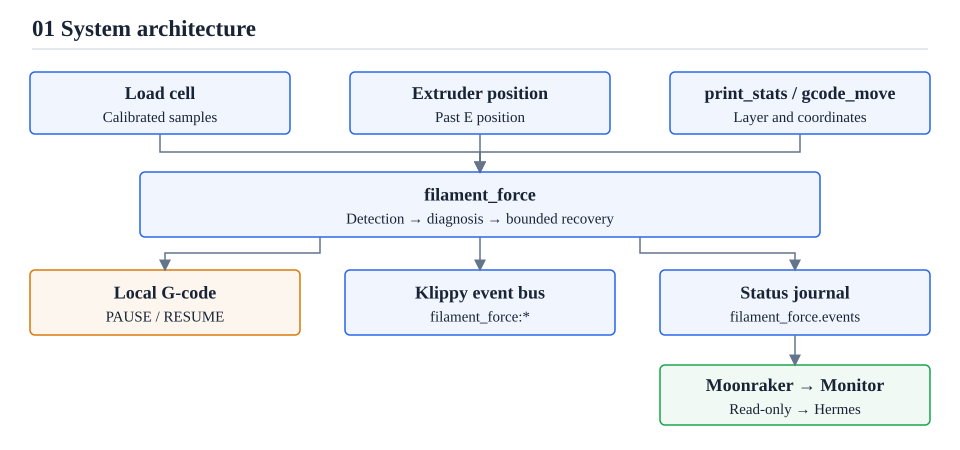

# filament_force

English | [简体中文](README.zh-CN.md)

Load-cell-based extrusion monitoring for Klipper/Kalico. Native Klippy extras package; no MCU rebuild or separate service.



## Features

- Speed-binned statistical jam and global runout detection; independent absolute-force limit.
- Persistent force references with restart validation.
- Opt-in free-air diagnosis, dual action hooks, bounded resume and first-layer Z feedback.
- Native events and Moonraker status journal with sensor traces; optional Hermes Monitor integration.

> Automatic diagnosis, resume and Z compensation are experimental and disabled by default. Hardware acceptance remains outstanding. The absolute threshold is not a hardware emergency stop; do not assume the default is safe. Cold calibration is optional and bypasses normal protection.

## Quick start

Requires a compatible Klipper/Kalico checkout and calibrated load_cell_probe or load_cell. Stop printing before installation.

```sh
cd ~
git clone https://github.com/wangyh775/klipper-filament-force.git
cd klipper-filament-force
./install.sh ~/klipper
```

Use the actual firmware path (e.g. ~/kalico). Include in printer.cfg:

```ini
[include filament_force.cfg]
```

Review the sample CFG and independently establish safe limits. Restart at idle, run FILAMENT_FORCE_QUERY, and learn with a supervised known-good print. Preserve the model and logs on a suspected false alarm; diagnose before resuming. See the user guide for optional calibration and staged recovery.

## Documentation

- [Installation](docs/INSTALL.md)
- [Configuration](docs/CONFIGURATION.md)
- [User guide](docs/USER_GUIDE.md)
- [Architecture](docs/ARCHITECTURE.md)
- [Algorithm](docs/ALGORITHM.md)
- [Diagnosis and recovery](docs/RECOVERY.md)
- [Event protocol](docs/events.md)
- [Troubleshooting](docs/TROUBLESHOOTING.md)
- [Testing](docs/TESTING.md)

[Example configuration](filament_force.cfg) · [Changelog](CHANGELOG.md) · [Hermes Monitor](https://github.com/wangyh775/hermes-plugin-kalico-monitor)

Documentation baseline: main 25b359b; diagrams are illustrative, not measured results.
