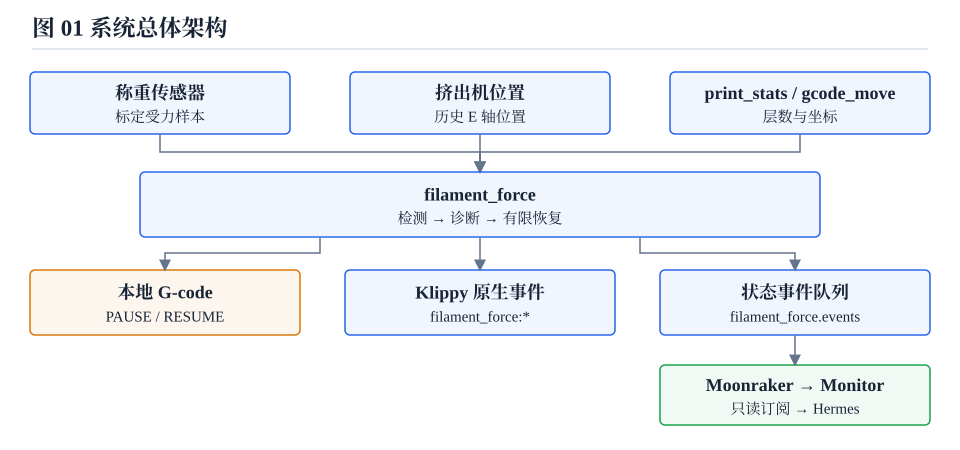

# filament_force

简体中文 | [English](README.md)

面向 Klipper/Kalico 的称重传感器挤出监测模块，以原生 Klippy Extras 加载，无需重新编译 MCU 或独立服务。



## 核心功能

- 速度分组统计堵头、全局断料及独立绝对力检测。
- 受力参考持久化与重启验证。
- 可选浮空诊断、双策略宏、有限自动恢复及首层 Z 反馈。
- 原生事件、Moonraker 受力事件队列及可选 Hermes Monitor 集成。

> 自动诊断、恢复及 Z 补偿为实验功能，默认关闭，尚未实机验收。绝对力阈值不是硬件急停，不应假定默认值安全。冷挤出标定为可选高级功能，绕过常规保护。

## 快速安装

需要兼容 Klipper/Kalico 源码及已标定 load_cell_probe 或 load_cell。安装前结束打印。

```sh
cd ~
git clone https://github.com/wangyh775/klipper-filament-force.git
cd klipper-filament-force
./install.sh ~/klipper
```

固件目录按实际修改（如 ~/kalico）。在 printer.cfg 加入：

```ini
[include filament_force.cfg]
```

核对示例 CFG，独立确定安全限值。空闲时重启，执行 FILAMENT_FORCE_QUERY，并监督正常打印学习。疑似误判保留模型和日志，诊断后恢复。高级标定和分阶段恢复见用户手册。

## 文档导航

- [安装与升级](docs/INSTALL.zh-CN.md)
- [配置参考](docs/CONFIGURATION.zh-CN.md)
- [用户手册](docs/USER_GUIDE.zh-CN.md)
- [系统架构](docs/ARCHITECTURE.zh-CN.md)
- [算法原理](docs/ALGORITHM.zh-CN.md)
- [诊断与恢复](docs/RECOVERY.zh-CN.md)
- [事件协议](docs/events.zh-CN.md)
- [故障排查](docs/TROUBLESHOOTING.zh-CN.md)
- [测试与验收](docs/TESTING.zh-CN.md)

[示例配置](filament_force.cfg) · [更新记录](CHANGELOG.md) · [Hermes Monitor](https://github.com/wangyh775/hermes-plugin-kalico-monitor)

文档基准 main 25b359b；配图是原理示意，非实测结果。
