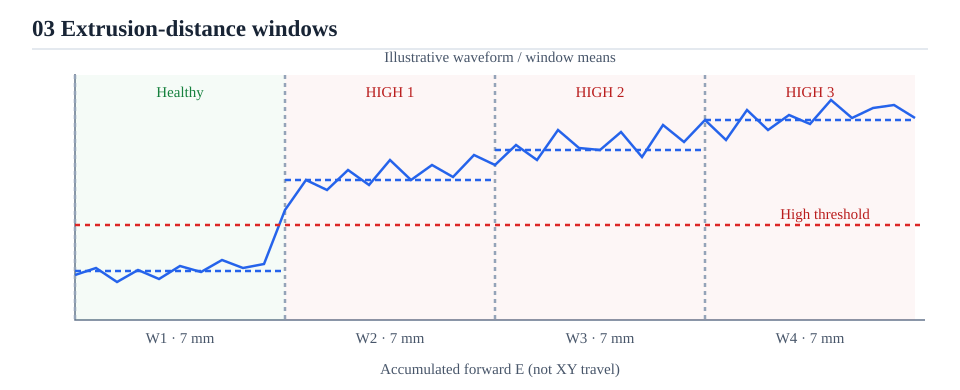
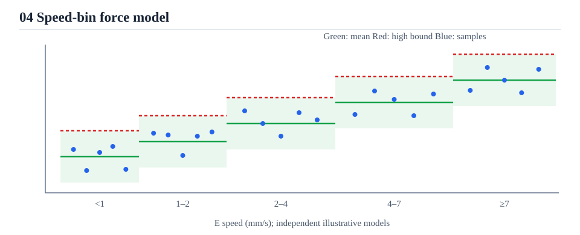

# Algorithm

English | [简体中文](ALGORITHM.zh-CN.md) · [Home](../README.md)

> Reference: main commit 25b359b. Automatic diagnosis, resume and Z compensation are opt-in and have not been qualified on hardware.

*Fig. 3. Synthetic force windows; the dashed levels are illustrative.*
## Signal and window

Use calibrated signed readings Fᵢ in gf and an idle reference F₀. For samples j within the trailing rolling interval Tᵣ, Rᵢ = ΣFⱼ / nᵢ. Window level Lₖ = Σ|Rᵢ − F₀| / Nₖ. The code accumulates eligible forward E increments until L_E ≥ detection_length (7 mm default); E is commanded filament displacement, not XY distance or measured flow. Distance-weighted speed v̄ = Σ(vⱼ ΔEⱼ)/ΣΔEⱼ. At constant speed the ideal duration is 7/v̄; actual polling and interruptions affect it. Empty windows are discarded; retraction/unretraction and extended idle are gated; a short first bead after idle cannot learn. Overshoot is not carried into the next window.

*Fig. 4. Independent illustrative speed-bin models.*
## Adaptive thresholds

For each tool and speed bin, maintain healthy levels (default 16, learn after 5). Default edges 1,2,4,7 mm/s. With mean μ and standard deviation σ:

- σ_eff = max(σ, min_delta_g, 0.08|μ|)
- H = μ + max(high_sigma × σ_eff, 0.5 min_delta_g)
- L_low = min(drop_ratio × μ, runout_max_level_g) when μ ≥ min_delta_g; otherwise 0.
- z = (Lₖ − μ)/σ_eff. HIGH if Lₖ > H; LOW if Lₖ ≤ L_low and the mean is sufficient. Runout uses a separate global per-tool history.

Default confirmation is 3 eligible anomalous windows; evidence expires after a gap >30 s, not a global 30 s sliding window. Healthy observations reset high streaks; unlearned and skipped windows do not constitute healthy proof. Absolute protection independently checks |Fᵢ−F₀| ≥ oh_shit_force for jam_dwell_s (0.15 s), with arming/reference/forward-E gates. A force trip is not a proven nozzle blockage.

## Persistence

Healthy histories are versioned and saved atomically; restored references score immediately but are validated before learning, with three matching eligible windows. Mismatch retains old data and may pause; never use fault windows as training. Separate profiles for material, nozzle, temperature, PA and load-cell changes. No persisted fault latch or recovery state.
