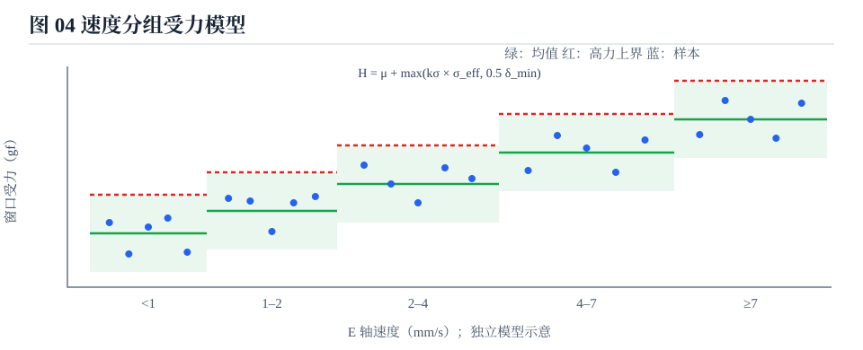

# 检测算法

简体中文 | [English](ALGORITHM.md) · [首页](../README.zh-CN.md)

> 依据 main 提交 25b359b。自动诊断、恢复、Z 补偿均须显式启用，尚未完成实机验收。

*图 3. 模拟窗口受力；虚线为示意统计值。*
## 信号与窗口

标定后的有符号受力 Fᵢ（gf），空闲基准 F₀。对落在尾随滑动时间 Tᵣ 内的样本 j，Rᵢ = ΣFⱼ / nᵢ；窗口特征 Lₖ = Σ|Rᵢ − F₀| / Nₖ。累计有效前向 E 进给直到 L_E ≥ detection_length（默认 7 mm）；E 是耗材指令位移，不是 XY 距离或实测出料。速度按进给量加权 v̄ = Σ(vⱼ ΔEⱼ)/ΣΔEⱼ。匀速理论时长 7/v̄，实际受轮询和中断影响。空窗口丢弃，回抽/复进及长空闲受门控，空闲后短首段不学习；超过目标的余量不转入下一窗口。

*图 4. 独立速度分组模型示意。*
## 自适应阈值

每工具、每速度组保存健康窗口（默认 16 个，5 个后学习完成），默认边界 1、2、4、7 mm/s。历史均值 μ、标准差 σ：

- σ_eff = max(σ, min_delta_g, 0.08|μ|)
- H = μ + max(high_sigma × σ_eff, 0.5 min_delta_g)
- μ ≥ min_delta_g 时 L_low = min(drop_ratio × μ, runout_max_level_g)，否则为 0。
- z = (Lₖ − μ)/σ_eff。Lₖ > H 为 HIGH；均值足够且 Lₖ ≤ L_low 为 LOW。断料采用独立的每工具全局参考。

默认 3 个有效异常窗口确认；相邻有效窗口间隔超过 30 s 清除确认累积，并非总长 30 s 滑窗。健康观测清除高力计数，未学习/跳过窗口不是健康证据。绝对保护独立判断 |Fᵢ−F₀| ≥ oh_shit_force 持续 jam_dwell_s（0.15 s），受布防、基准及前向 E 门控。受力异常不等于堵塞确证。

## 持久化

健康历史以版本化 JSON 原子写入；恢复后立即参考旧模型检测，但需连续三个匹配有效窗口验证后才学习。失配保留旧数据并可能暂停，不将故障数据作为训练。材料、喷嘴、温度、PA、传感器变化使用独立 profile。故障锁存及恢复状态不持久化。
