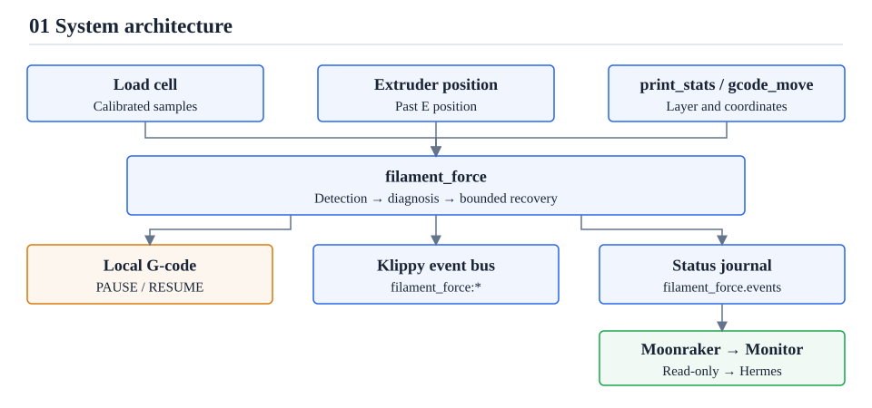
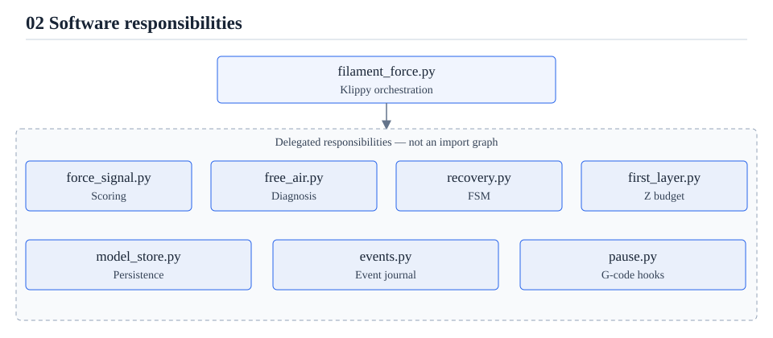

# Architecture

English | [简体中文](ARCHITECTURE.zh-CN.md) · [Home](../README.md)

> Reference: main commit 25b359b. Automatic diagnosis, resume and Z compensation are opt-in and have not been qualified on hardware.

*Fig. 1. Local control and remote observation.*
The package runs inside Klippy, not as an independent daemon. Load-cell data and historical commanded E motion enter the host reactor; detection, pause, diagnostic motion and recovery decisions stay local. Moonraker reads get_status(); native Klippy events are a separate local interface. Monitor consumes events, not motion commands.

*Fig. 2. File responsibilities, not a Python import graph.*
The main orchestrator owns arming, job generation, sensor callbacks, polling, G-code integration and status. Pure helpers encapsulate scoring, diagnosis, recovery and event buffering. Model snapshots use a single disk worker; sampling does not perform network or disk I/O. Stale generation callbacks must not act on a new job. See [recovery](RECOVERY.md) and [events](events.md).