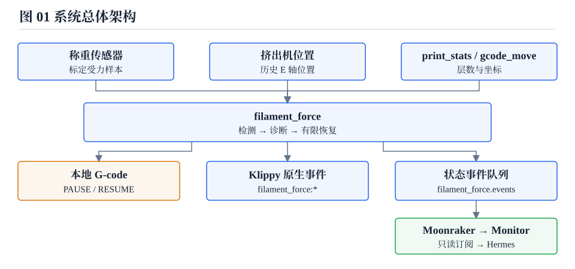
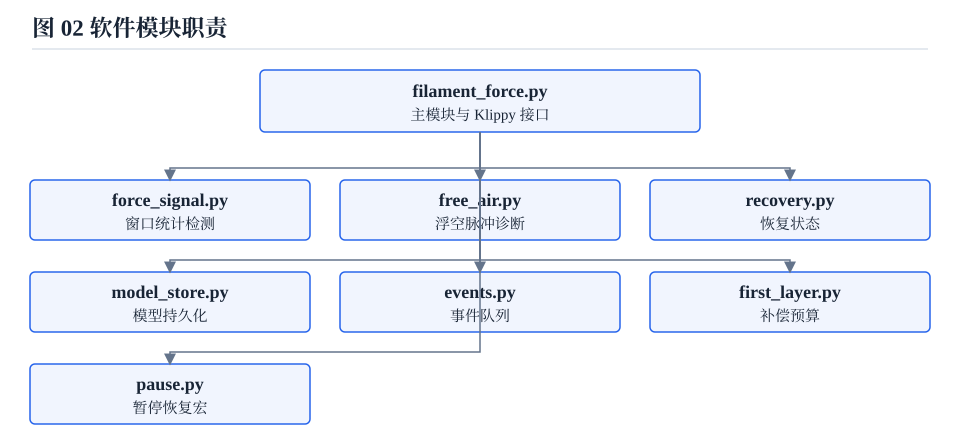

# 系统架构

简体中文 | [English](ARCHITECTURE.md) · [首页](../README.zh-CN.md)

> 依据 main 提交 25b359b。自动诊断、恢复、Z 补偿均须显式启用，尚未完成实机验收。

*图 1. 本地控制与远程观测。*
模块运行在 Klippy 主机进程内，不是独立守护服务。受力与历史 E 指令运动进入 reactor；检测、暂停、诊断运动、恢复均留在本地。Moonraker 读取 get_status()；原生事件是独立本地接口。Monitor 消费事件而非控制运动。

*图 2. 文件职责，并非 Python import 依赖图。*
主模块负责布防、任务代次、采样回调、轮询、G-code 与状态。纯函数/状态模块负责评分、诊断、恢复与事件缓冲。模型快照使用独立磁盘线程；采样路径不联网、不写盘。旧任务回调不得操作新任务。参见 [恢复](RECOVERY.zh-CN.md) 与 [事件](events.zh-CN.md)。