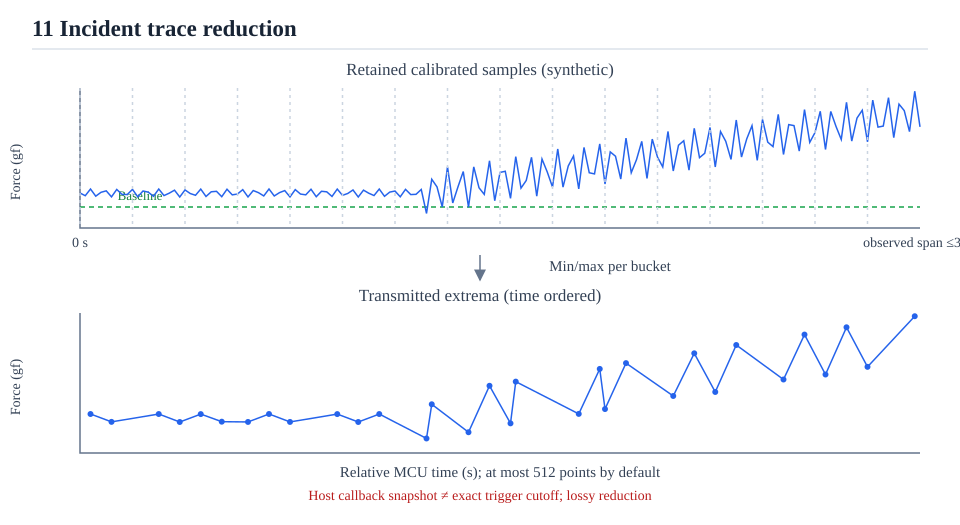

# Event protocol

English | [简体中文](EVENTS.zh-CN.md) · [Home](../README.md)

> Reference: main commit 25b359b. Automatic diagnosis, resume and Z compensation are opt-in and have not been qualified on hardware.



*Fig. 11. Synthetic pre-trip force trace, not a full-rate dataset.*
Klippy local listeners receive a dictionary with `printer.register_event_handler("filament_force:jam_detected", handler)`. Remote clients subscribe to the independent `get_status` journal; no Moonraker patch needed. Native events are not automatically relayed.

```json
{"jsonrpc":"2.0","method":"printer.objects.subscribe","params":{"objects":{"filament_force":["events"]}},"id":1}
```

| kind | Monitor | Meaning |
|---|---|---|
| jam_detected | filament_jam_detected | Suspected jam |
| runout_detected | filament_runout_detected | Low force |
| diagnosis_result | filament_diagnosis_result | Free-air result |
| jam_confirmed | filament_jam_confirmed | Repeated high resistance |
| z_adjusted | filament_z_adjusted | Offset acknowledged |
| recovery_started | filament_recovery_started | Resume acknowledged |
| recovery_verified | filament_recovery_verified | Healthy windows |
| recovery_failed | filament_recovery_failed | Covered failure path |

Schema 1: boot_id (random per instance), seq, event_id=boot_id:seq, kind, host_monotonic_s, incident_id, filename. Initial detection has null incident_id; children reference its event_id. Detection includes source, layer, tool, force_g, e_speed_mm_s, target_c, detection_length_mm, absolute_limit_g and window. Window: clock, start_time, duration_s, sample_count, returned_count, downsampled, force_ref_g, columns, samples and recent windows. Each sample is [relative MCU print time s, signed calibrated gf]; statistical window times use host monotonic clock, not UTC. Do not subtract clocks. Independent trace may include idle/travel; max 40,000 readings in memory, 30 s by default, at most 512 transmitted points, 32 statistical summaries. Min/max bucket reduction is lossy. Journal holds last 16 events only; restart/long disconnection can lose unread events. Monitor SQLite deduplicates source ID and forwards structured event in signed webhook JSON. See legacy [protocol](events.md).