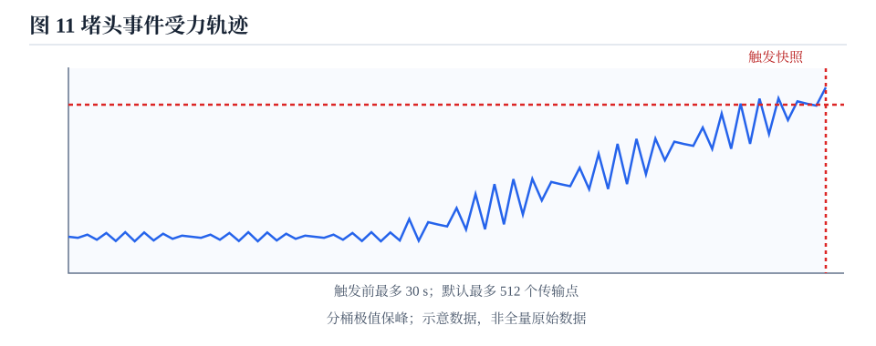

# 事件协议

简体中文 | [English](EVENTS.md) · [首页](../README.zh-CN.md)

> 依据 main 提交 25b359b。自动诊断、恢复、Z 补偿均须显式启用，尚未完成实机验收。



*图 11. 故障前受力轨迹示意，非完整采样数据。*
Klippy 本地监听通过 `printer.register_event_handler("filament_force:jam_detected", handler)` 接收字典。远程订阅独立 get_status 队列；无需修改 Moonraker，原生事件不会自动转发。

```json
{"jsonrpc":"2.0","method":"printer.objects.subscribe","params":{"objects":{"filament_force":["events"]}},"id":1}
```

| kind | Monitor | 含义 |
|---|---|---|
| jam_detected | filament_jam_detected | 疑似堵头 |
| runout_detected | filament_runout_detected | 断料/送料异常 |
| diagnosis_result | filament_diagnosis_result | 浮空结果 |
| jam_confirmed | filament_jam_confirmed | 重复高阻力 |
| z_adjusted | filament_z_adjusted | 确认偏移 |
| recovery_started | filament_recovery_started | 恢复验证 |
| recovery_verified | filament_recovery_verified | 健康窗口 |
| recovery_failed | filament_recovery_failed | 已覆盖失败路径 |

Schema 1：boot_id（每 Klippy 实例随机）、seq、event_id=boot_id:seq、kind、host_monotonic_s、incident_id、filename。初始检测 incident_id=null，后续关联其 event_id。检测字段 source、layer、tool、force_g、e_speed_mm_s、target_c、detection_length_mm、absolute_limit_g、window。窗口含 clock、start_time、duration_s、sample_count、returned_count、downsampled、force_ref_g、columns、samples、windows。每采样点 [相对 MCU print time 秒, 有符号标定 gf]；统计窗口使用 host monotonic 时间，不是 UTC，不可直接相减。独立轨迹可能含空闲/移动，内存最多 40000 点、默认 30 s、传输最多 512 点、最近 32 个统计窗口。分桶极值降采样有损。仅保留最近 16 条事件，重启或长断线可丢失未读事件。Monitor SQLite 按源 ID 去重，并将结构化 event 通过签名 Webhook 转发。旧版入口 [协议](events.md)。