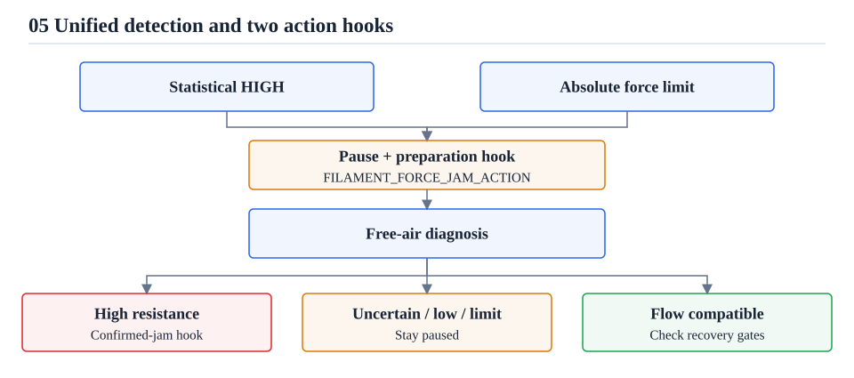
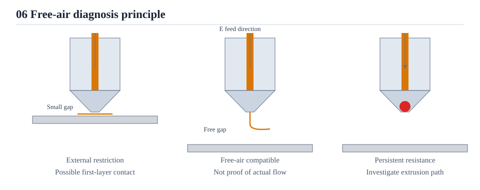
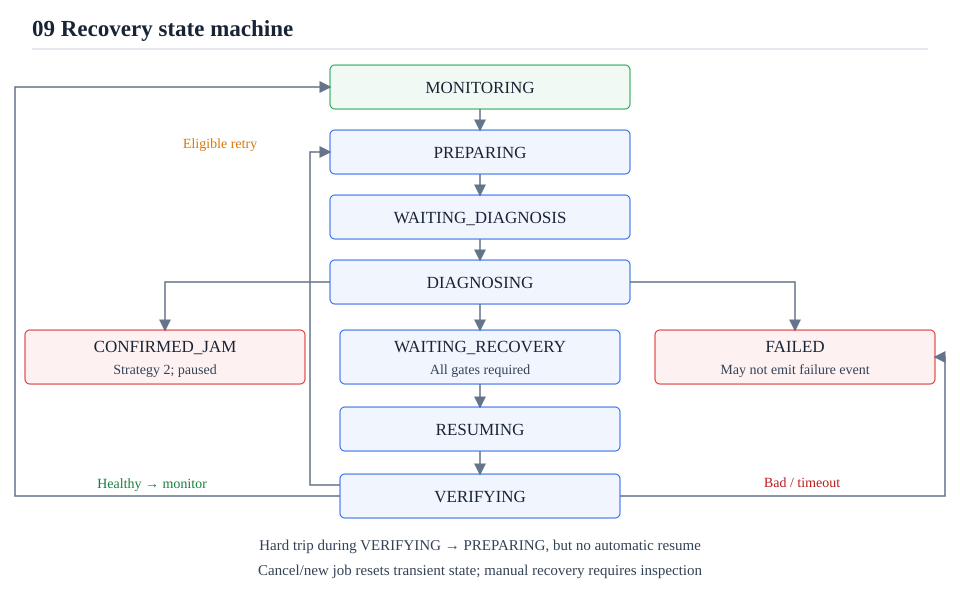

# Diagnosis & recovery

English | [简体中文](RECOVERY.zh-CN.md) · [Home](../README.md)

> Reference: main commit 25b359b. Automatic diagnosis, resume and Z compensation are opt-in and have not been qualified on hardware.

*Fig. 5. Both jam sources share one diagnosis path.*
Core pauses before the weak preparation hook `FILAMENT_FORCE_JAM_ACTION`. Custom hook receives TOOL, SOURCE, FORCE_G, E_SPEED, TARGET, FIRST_LAYER. Only after a safe machine-specific park and M400 may it issue `FILAMENT_FORCE_DIAG_READY CLEARANCE=1`. Default grants no clearance. `FILAMENT_FORCE_CONFIRMED_JAM_ACTION` handles repeated high free-air resistance and defaults to a paused message; adds DIAG_MEAN_G, DIAG_PEAK_G, RESULT. Runout remains separate.

*Fig. 6. Physical interpretation; not proof of flow.*

*Fig. 7. Nominal pulse timing; not measured data.*
Default speed 3 mm/s, optional matching caps incident speed at configured speed. Actual E length max(configured minimum, v×0.5 s), default 1.5 mm ×3. Idle median reference from 0.8 s, at least five samples and max span 30 gf by default. Score middle 60% of nominal move, with coverage checks; mean absolute force relative to reference. Peak cap = min(diagnostic_force_limit, oh_shit_force); stops subsequent pulses, not queued motion. All means high → restriction_suspected; all low → low_force; all within bounds → flow_compatible; mixed/missing/invalid → inconclusive; limit → force_limit. Learned reference of diagnostic bin preferred, manual bounds fallback cannot authorize automatic resume. At/above incident speed may cross bins only with trusted references; slower test requires same bin and ≥80% incident speed. No independent free-air learning. A positive diagnosis does not prove flow; higher-speed cross-bin assumption requires hardware validation.

*Fig. 8. Bounded feedback, not a fitted force–gap curve.*
Recovery requires opt-in, same tool/temperature, known layer, validated model and explicit tested resume_gcode. Non-first layer never adjusts Z. Layer 1 also requires first_layer_z_enabled and original homed/height gate. Shift compatible PAUSE_STATE base_position, homing_position and last_position together; verify restored origin. Default +0.02 mm, maximum 3 and 0.06 mm per job, cooldown 10 s. Compare normalized deviations: improvement = 1 − z_after/z_before when z_before > 0 and based on comparable window data. Hard peaks are not comparable. Two healthy first-layer windows or three ordinary windows complete verification; 60 s timeout, low/no improvement/budget exhaustion pause. Healthy observed printing for 60 s resets consecutive attempts, not total or Z budget. On job end attempt to undo only owned offsets when origin is unchanged; manual check after crash.

*Fig. 9. Principal state transitions; all motion remains conditional.*

## Exact diagnostic and recovery gates

For pulse j, mean m_j = average(|Fᵢ−F_idle|) over the middle 60% of the nominal interval; peak p_j is the maximum absolute deviation of captured pulse samples. A usable learned reference requires finite μ,σ, μ > min_delta_g > 0, σ ≥ 0 and high_sigma > 0. The diagnostic lower bound is max(min_delta_g, L_low); require 0 < lower < H < cap, without clamping H. Otherwise manual bounds may classify, but cannot authorize automatic recovery. The short-pulse statistic is not equivalent to the rolling printing statistic; cross-bin qualification is an empirical engineering assumption. Baseline is 0.8 s, nominal pulse at least 0.5 s, M400 and 0.3 s wait per pulse. Actual motion timing is planner-dependent.

Recovery additionally requires a band/hard incident (not model_validation), known layer, both trusted bins/global reference, the same active extruder, actual and target temperatures each within 10 °C of the original positive target, heater.can_extrude, and a tested resume template. A hard trip during VERIFYING is diagnosed but cannot automatically recover. First-layer adjustment also requires every diagnostic pulse mean ≤ first_layer_z_max_force. Non-first-layer attempts use the ordinary budget; first-layer steps use the separate per-job Z budget.

VERIFYING counts healthy windows and consecutive bad windows. NONE resets bad; a bad window resets healthy. A missing/unvalidated reference resets healthy; short windows are skipped. At confirm_windows bad (default 3), HIGH may retry if budget remains and first-layer normalized improvement is sufficient; LOW or insufficient improvement stops verification. Independent 60 s watchdog can pause even without usable windows. Failure is not always a recovery_failed event; inspect recovery_state and recovery_failure as well. A pause request is not an emergency hardware stop.
