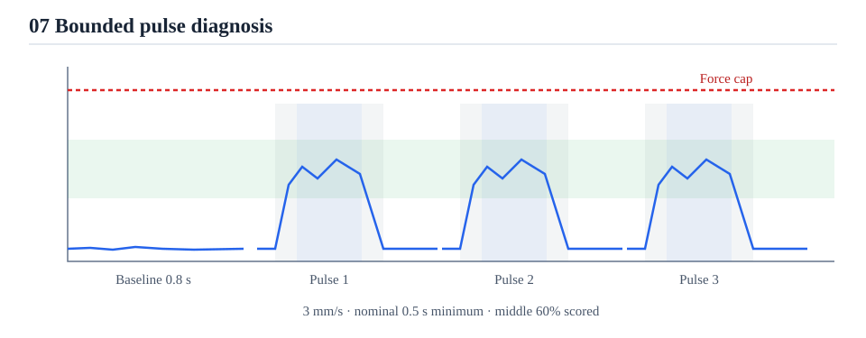
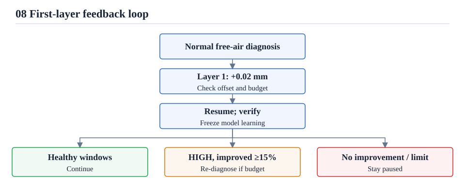

# Diagnosis & recovery

English | [简体中文](RECOVERY.zh-CN.md) · [Home](../README.md)

> Reference: main commit 25b359b. Automatic diagnosis, resume and Z compensation are opt-in and have not been qualified on hardware.

*Fig. 5. Both jam sources share one diagnosis path.*
Core pauses before the weak preparation hook `FILAMENT_FORCE_JAM_ACTION`. Custom hook receives TOOL, SOURCE, FORCE_G, E_SPEED, TARGET, FIRST_LAYER. Only after a safe machine-specific park and M400 may it issue `FILAMENT_FORCE_DIAG_READY CLEARANCE=1`. Default grants no clearance. `FILAMENT_FORCE_CONFIRMED_JAM_ACTION` handles repeated high free-air resistance and defaults to a paused message; adds DIAG_MEAN_G, DIAG_PEAK_G, RESULT. Runout remains separate.

*Fig. 6. Physical interpretation; not proof of flow.*

*Fig. 7. Nominal pulse timing; not measured data.*
Default speed 3 mm/s, optional matching caps incident speed at configured speed. Actual E length max(configured minimum, v×0.5 s), default 1.5 mm ×3. Idle median reference from 0.8 s, at least five samples and max span 30 gf by default. Score middle 60% of nominal move, with coverage checks; mean absolute force relative to reference. Peak cap = min(diagnostic_force_limit, oh_shit_force); stops subsequent pulses, not queued motion. All means high → restriction_suspected; all low → low_force; all within bounds → flow_compatible; mixed/missing/invalid → inconclusive; limit → force_limit. Learned reference of diagnostic bin preferred, manual bounds fallback cannot authorize automatic resume. At/above incident speed may cross bins only with trusted references; slower test requires same bin and ≥80% incident speed. No independent free-air learning. A positive diagnosis does not prove flow; higher-speed cross-bin assumption requires hardware validation.

*Fig. 8. Bounded feedback, not a fitted force–gap curve.*
Recovery requires opt-in, same tool/temperature, known layer, validated model and explicit tested resume_gcode. Non-first layer never adjusts Z. Layer 1 also requires first_layer_z_enabled and original homed/height gate. Shift compatible PAUSE_STATE base_position, homing_position and last_position together; verify restored origin. Default +0.02 mm, maximum 3 and 0.06 mm per job, cooldown 10 s. Compare normalized deviations: improvement = 1 − z_after/z_before when z_before > 0 and based on comparable window data. Hard peaks are not comparable. Two healthy first-layer windows or three ordinary windows complete verification; 60 s timeout, low/no improvement/budget exhaustion pause. Healthy observed printing for 60 s resets consecutive attempts, not total or Z budget. On job end attempt to undo only owned offsets when origin is unchanged; manual check after crash.

*Fig. 9. Principal state transitions; all motion remains conditional.*
