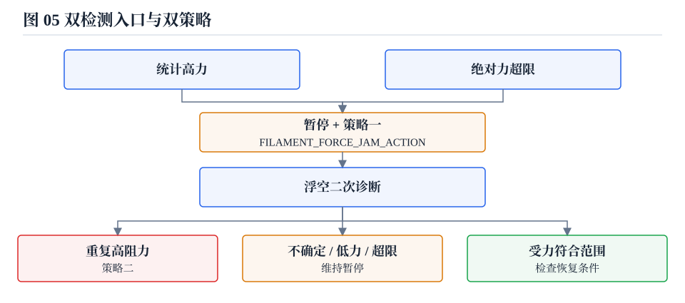
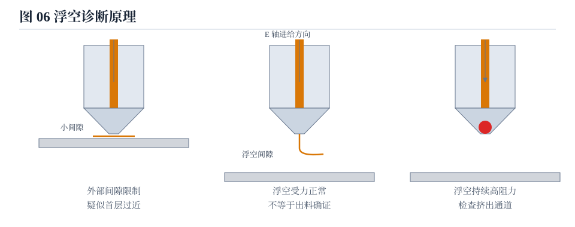
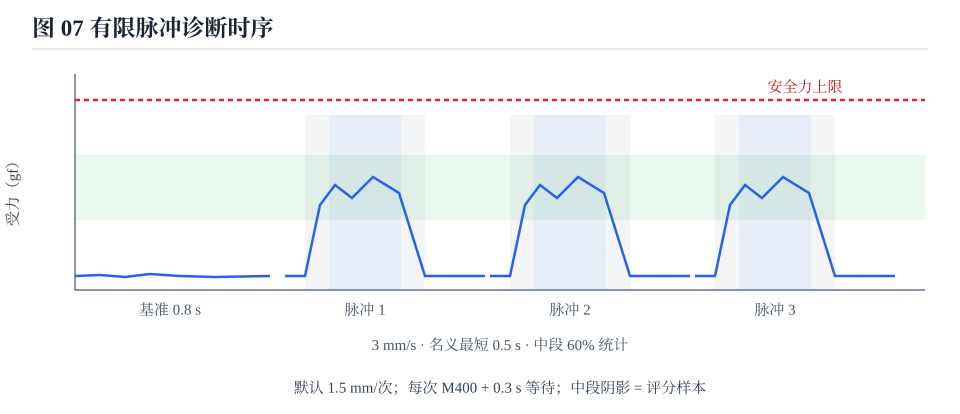
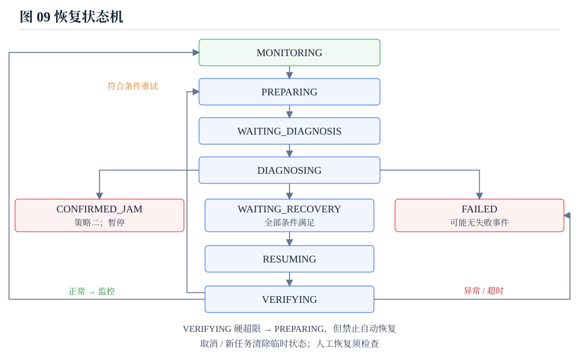

# 诊断与恢复

简体中文 | [English](RECOVERY.md) · [首页](../README.zh-CN.md)

> 依据 main 提交 25b359b。自动诊断、恢复、Z 补偿均须显式启用，尚未完成实机验收。

*图 5. 两种堵头来源共享诊断入口。*
核心先暂停，再执行弱定义准备宏 `FILAMENT_FORCE_JAM_ACTION`，参数 TOOL、SOURCE、FORCE_G、E_SPEED、TARGET、FIRST_LAYER。设备安全停靠且 M400 后才可执行 `FILAMENT_FORCE_DIAG_READY CLEARANCE=1`。默认不授权。`FILAMENT_FORCE_CONFIRMED_JAM_ACTION` 处理重复浮空高阻力，默认保持暂停并提示；新增 DIAG_MEAN_G、DIAG_PEAK_G、RESULT。断料独立处理。

*图 6. 物理解释，不是出料确证。*

*图 7. 名义脉冲时序，非实测。*
默认速度 3 mm/s，可选匹配模式以配置速度为上限。实际 E 长度 max(配置最小长度, v×0.5 s)，默认 1.5 mm×3。空闲 0.8 s 取中位数，至少五个样本，默认最大跨度 30 gf。名义运动中段 60% 统计基准相对绝对力，检查覆盖。峰值上限 min(diagnostic_force_limit, oh_shit_force)，只能阻止后续脉冲，不能取消队列中运动。全部高力→restriction_suspected；全部低力→low_force；全部在范围内→flow_compatible；混合/缺失/范围无效→inconclusive；超限→force_limit。优先诊断速度组模型，人工备用范围不能授权自动恢复。诊断速度不低于触发速度时可跨可信组；较低速度需同组且 ≥80% 触发速度。不独立学习浮空模型。正常受力不证明出料；跨组假设须实机验证。

*图 8. 有限反馈策略，不是拟合的力—间隙曲线。*
恢复需显式启用、同工具/温度、明确层数、可信模型及实测 resume_gcode。非首层不调 Z；首层还要求 first_layer_z_enabled 与原始归零/高度条件。同步调整兼容 PAUSE_STATE 的 base_position、homing_position、last_position，并核对恢复后原点。默认 +0.02 mm，单任务最多 3 次/0.06 mm，间隔 10 s。比较归一化异常：z_before > 0 且窗口口径可比时，改善率 = 1 − z_after/z_before。绝对峰值不可直接比较。首层两个正常窗口或普通三个完成验证；60 s 超时，低力/无改善/预算耗尽暂停。健康观测 60 s 后重置连续次数，不清零累计或 Z 预算。结束时仅在原点未改变时尝试撤销本模块偏移；崩溃后人工确认。

*图 9. 主要状态转换，运动均须满足条件。*
