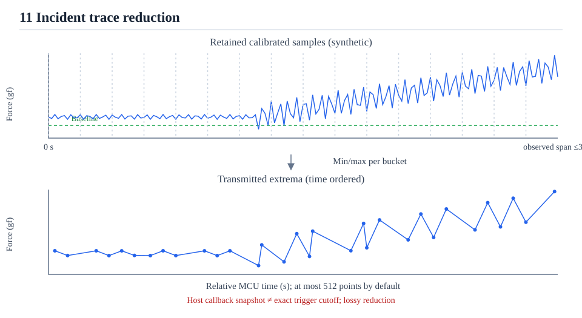

# Event protocol

English | [简体中文](events.zh-CN.md) · [Home](../README.md)

> Reference: main commit 25b359b. Automatic diagnosis, resume and Z compensation are opt-in and have not been qualified on hardware.



*Fig. 11. Synthetic pre-trip force trace, not a full-rate dataset.*
Klippy local listeners receive a dictionary with `printer.register_event_handler("filament_force:jam_detected", handler)`. Remote clients subscribe to the independent `get_status` journal; no Moonraker patch needed. Native events are not automatically relayed.

```json
{"jsonrpc":"2.0","method":"printer.objects.subscribe","params":{"objects":{"filament_force":["events"]}},"id":1}
```

| kind | Monitor | Meaning |
|---|---|---|
| jam_detected | filament_jam_detected | Suspected jam |
| runout_detected | filament_runout_detected | Low force |
| diagnosis_result | filament_diagnosis_result | Free-air result |
| jam_confirmed | filament_jam_confirmed | Repeated high resistance |
| z_adjusted | filament_z_adjusted | Offset acknowledged |
| recovery_started | filament_recovery_started | Resume acknowledged |
| recovery_verified | filament_recovery_verified | Healthy windows |
| recovery_failed | filament_recovery_failed | Covered failure path |

Schema 1: boot_id (random per instance), seq, event_id=boot_id:seq, kind, host_monotonic_s, incident_id, filename. Initial detection has null incident_id; children reference its event_id. Detection includes source, layer, tool, force_g, e_speed_mm_s, target_c, detection_length_mm, absolute_limit_g and window. Window: clock, start_time, duration_s, sample_count, returned_count, downsampled, force_ref_g, columns, samples and recent windows. Each sample is [relative MCU print time s, signed calibrated gf]; statistical window times use host monotonic clock, not UTC. Do not subtract clocks. Independent trace may include idle/travel; max 40,000 readings in memory, 30 s by default, at most 512 transmitted points, 32 statistical summaries. Min/max bucket reduction is lossy. Journal holds last 16 events only; restart/long disconnection can lose unread events. Monitor SQLite deduplicates source ID and forwards structured event in signed webhook JSON.

## Diagnosis and recovery event fields

diagnosis_result carries result, diagnostic_speed_mm_s, reference_compatible, pulse_means_g, pulse_peaks_g and extruded_mm. z_adjusted carries step_mm and total_mm. recovery_started and recovery_verified carry attempts; the latter adds before_z_score, after_z_score and improvement (possibly null). recovery_failed carries reason; not every failure path emits this event. Incident linkage applies to the same fault episode.

Illustrative abbreviated schema, not measured values:

```json
{
  "schema": 1,
  "boot_id": "aaaaaaaaaaaaaaaaaaaaaaaaaaaaaaaa",
  "seq": 12,
  "event_id": "aaaaaaaaaaaaaaaaaaaaaaaaaaaaaaaa:12",
  "incident_id": null,
  "kind": "jam_detected",
  "source": "hard",
  "layer": 1,
  "force_g": 4200.0,
  "e_speed_mm_s": 1.0,
  "window": {
    "clock": "mcu_print_time",
    "columns": ["t_s", "force_g"],
    "samples": [[0.0, 530.0], [0.1, 4200.0]]
  }
}
```

For remote transport and routing figures see [Monitor](https://github.com/wangyh775/hermes-plugin-kalico-monitor/blob/main/docs/ARCHITECTURE.md).


## Field reference and snapshot semantics

| Field | Type | Meaning |
|---|---|---|
| schema, seq | integer | Version 1, increasing boot-local counter |
| boot_id, event_id, kind, filename | string | Boot identity, source ID, event name, original filename |
| incident_id | string/null | Parent detection ID, null for initial event |
| host_monotonic_s | number | Host-local monotonic seconds |
| source | string | band, hard, model_validation |
| layer | integer/null | Known slicer layer, if available |
| tool | integer | Active tool; -1 is default/unknown |
| force_g | number | Window level for band/model_validation; absolute baseline-relative trigger reading for hard, not necessarily peak |
| e_speed_mm_s, detection_length_mm | number | Incident commanded E speed (0 if unknown), window length |
| target_c, absolute_limit_g | number | Original target °C, configured absolute limit gf |
| window.clock, window.columns | string, array | MCU print-time clock, [t_s, force_g] |
| window.start_time, window.force_ref_g | number/null | MCU time origin and locked reference |
| window.duration_s, sample_count, returned_count, downsampled | number, integer, integer, boolean | Observed trace span and retained/transmitted counts |
| window.samples | array of pairs | Relative seconds and signed calibrated gf, not baseline-subtracted |
| window.windows | array of objects | Recent window summaries: host_monotonic_s, duration_s, e_speed_mm_s, force_g, bin, short_bead; scoring fields mean_g, stdev_g, z_score, anomaly, learned may be absent |
| result, reason | string | Diagnosis result or covered failure reason |
| diagnostic_speed_mm_s, extruded_mm | number | Diagnostic command speed and commanded E total |
| pulse_means_g, pulse_peaks_g | array of numbers | Recorded valid pulse statistics |
| reference_compatible | boolean | Reference/speed gate, not full recovery eligibility |
| step_mm, total_mm | number | Applied offset increments, mm |
| attempts | integer | Consecutive recovery attempts |
| before_z_score, after_z_score, improvement | number/null | Normalized metrics, may be null or outside 0–1 |

Snapshot is generated in the host fault callback, not at the precise sensor threshold timestamp; it can include samples later than the triggering sample. Window summaries have a separate 32-entry retention, not necessarily the same 30 s. Do not correlate host and MCU clocks by subtraction. Observers must be nonblocking; no network, disk or actuation in native event listeners. Monitor's signed delivery is separate. A FAILED state may occur without recovery_failed.

[Complete synthetic fixture](examples/jam-event.json) for integration testing (no physical fault or actual recorded data).
