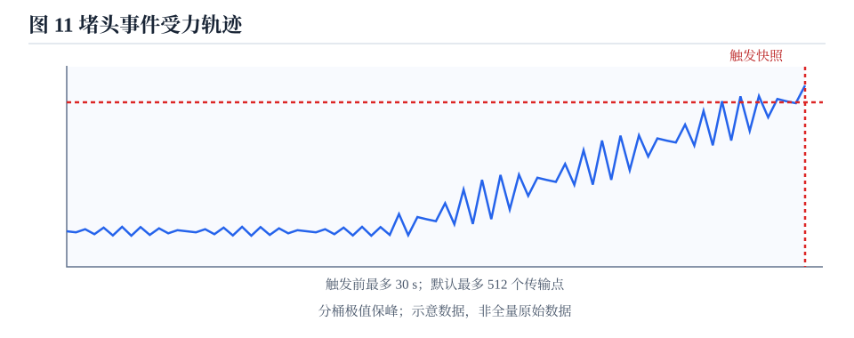

# 事件协议

简体中文 | [English](events.md) · [首页](../README.zh-CN.md)

> 依据 main 提交 25b359b。自动诊断、恢复、Z 补偿均须显式启用，尚未完成实机验收。



*图 11. 故障前受力轨迹示意，非完整采样数据。*
Klippy 本地监听通过 `printer.register_event_handler("filament_force:jam_detected", handler)` 接收字典。远程订阅独立 get_status 队列；无需修改 Moonraker，原生事件不会自动转发。

```json
{"jsonrpc":"2.0","method":"printer.objects.subscribe","params":{"objects":{"filament_force":["events"]}},"id":1}
```

| kind | Monitor | 含义 |
|---|---|---|
| jam_detected | filament_jam_detected | 疑似堵头 |
| runout_detected | filament_runout_detected | 断料/送料异常 |
| diagnosis_result | filament_diagnosis_result | 浮空结果 |
| jam_confirmed | filament_jam_confirmed | 重复高阻力 |
| z_adjusted | filament_z_adjusted | 确认偏移 |
| recovery_started | filament_recovery_started | 恢复验证 |
| recovery_verified | filament_recovery_verified | 健康窗口 |
| recovery_failed | filament_recovery_failed | 已覆盖失败路径 |

Schema 1：boot_id（每 Klippy 实例随机）、seq、event_id=boot_id:seq、kind、host_monotonic_s、incident_id、filename。初始检测 incident_id=null，后续关联其 event_id。检测字段 source、layer、tool、force_g、e_speed_mm_s、target_c、detection_length_mm、absolute_limit_g、window。窗口含 clock、start_time、duration_s、sample_count、returned_count、downsampled、force_ref_g、columns、samples、windows。每采样点 [相对 MCU print time 秒, 有符号标定 gf]；统计窗口使用 host monotonic 时间，不是 UTC，不可直接相减。独立轨迹可能含空闲/移动，内存最多 40000 点、默认 30 s、传输最多 512 点、最近 32 个统计窗口。分桶极值降采样有损。仅保留最近 16 条事件，重启或长断线可丢失未读事件。Monitor SQLite 按源 ID 去重，并将结构化 event 通过签名 Webhook 转发。

## 诊断及恢复事件字段

diagnosis_result 携带 result、diagnostic_speed_mm_s、reference_compatible、pulse_means_g、pulse_peaks_g、extruded_mm。z_adjusted 携带 step_mm、total_mm。recovery_started 与 recovery_verified 携带 attempts，后者额外携带 before_z_score、after_z_score、improvement（可能为 null）。recovery_failed 携带 reason，但并非所有失败路径都发出该事件。初始事件关联后续事件仅在同一故障期间有效。

以下为简化结构示例，数值不是实测：

```json
{
  "schema": 1,
  "boot_id": "aaaaaaaaaaaaaaaaaaaaaaaaaaaaaaaa",
  "seq": 12,
  "event_id": "aaaaaaaaaaaaaaaaaaaaaaaaaaaaaaaa:12",
  "incident_id": null,
  "kind": "jam_detected",
  "source": "hard",
  "layer": 1,
  "force_g": 4200.0,
  "e_speed_mm_s": 1.0,
  "window": {
    "clock": "mcu_print_time",
    "columns": ["t_s", "force_g"],
    "samples": [[0.0, 530.0], [0.1, 4200.0]]
  }
}
```

远程链路图及路由说明参见 [Monitor](https://github.com/wangyh775/hermes-plugin-kalico-monitor/blob/main/docs/ARCHITECTURE.zh-CN.md).


## 字段与采样边界

| 字段 | 类型 | 含义 |
|---|---|---|
| schema、seq | 整数 | 版本 1、单次启动递增序号 |
| boot_id、event_id、kind、filename | 字符串 | 启动标识、源事件 ID、类型、原始文件名 |
| incident_id | 字符串/null | 初始检测 ID，初始事件为 null |
| host_monotonic_s | 数值 | 主机单调时钟秒 |
| source | 字符串 | band、hard、model_validation |
| layer | 整数/null | 已知切片层数 |
| tool | 整数 | 活动工具，-1 为默认/未知 |
| force_g | 数值 | band/model_validation 为窗口特征；hard 为触发采样相对基准绝对力，不一定是峰值 |
| e_speed_mm_s、detection_length_mm | 数值 | 故障 E 指令速度（未知为 0）、窗口长度 |
| target_c、absolute_limit_g | 数值 | 原目标 ℃、配置绝对力上限 gf |
| window.clock、window.columns | 字符串、数组 | MCU print-time 时钟、[t_s, force_g] |
| window.start_time、window.force_ref_g | 数值/null | MCU 时间原点、锁定基准 |
| window.duration_s、sample_count、returned_count、downsampled | 数值、整数、整数、布尔 | 实际轨迹时长及保留/传输计数 |
| window.samples | 二元组数组 | 相对秒、有符号标定 gf，未减基准 |
| window.windows | 对象数组 | 最近窗口：host_monotonic_s、duration_s、e_speed_mm_s、force_g、bin、short_bead；mean_g、stdev_g、z_score、anomaly、learned 等评分字段可能缺失 |
| result、reason | 字符串 | 诊断结果或已覆盖的失败原因 |
| diagnostic_speed_mm_s、extruded_mm | 数值 | 诊断指令速度及累计指令 E |
| pulse_means_g、pulse_peaks_g | 数值数组 | 已记录有效脉冲统计 |
| reference_compatible | 布尔 | 参考与速度门控，不是完整恢复授权 |
| step_mm、total_mm | 数值 | 已应用补偿，mm |
| attempts | 整数 | 连续恢复尝试次数 |
| before_z_score、after_z_score、improvement | 数值/null | 归一化指标，可为空或超出 0–1 |

快照在主机故障回调生成，并非精确截止物理触发采样，可能包含触发后样本。统计窗口独立保留最近 32 条，不保证与 30 秒轨迹重合。不可直接相减主机与 MCU 时钟。原生事件监听者不得阻塞、联网、写盘或控制运动；Monitor 投递独立。FAILED 可能不发送 recovery_failed。

[完整模拟 JSON](examples/jam-event.json) 用于接口联调（不产生实际故障，非实测数据）。
